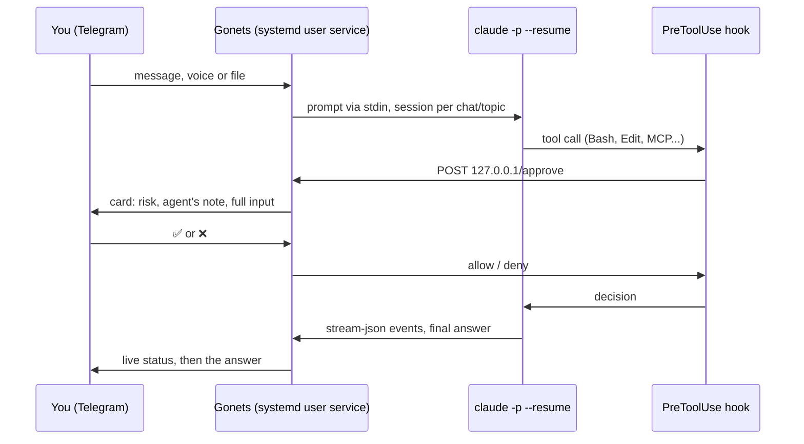

# Gonets

Gonets is a Telegram bridge to [Claude Code](https://docs.claude.com/en/docs/claude-code/overview)
that runs on your own machine as an always-on service. Every message you send
starts `claude -p --resume` in your workspace, and every risky tool call comes
back to your phone as an approval card with a risk estimate. You approve or
reject it with one tap.

*Gonets* (гонец) is Russian for "messenger". It was written for one person who
runs a coding agent all day and wanted to keep working from a phone without
handing it unchecked shell access. Its sibling project
[domovoy-agent](https://github.com/ivbala1/domovoy-agent) uses it as a
transport for a proactive personal assistant.

> **Status.** This is a personal project, published as is. It runs daily on
> its author's machine. Issues and discussions are read, but no response or
> support is promised. Code comments and the original commit history are in
> Russian; bot messages are in English by default (`CLAUDE_TG_BOT_LANG=ru`
> switches them to Russian).

## How it differs from other options

| | Gonets | Claude Code Channels | Remote Control | tmux-based bridges |
|---|---|---|---|---|
| What runs | a service that starts `claude -p` per message | events pushed into an interactive session you keep open | you drive local sessions from the Claude app or claude.ai | a bot types into tmux windows |
| Parallel sessions | one per chat and per forum topic | one per running `claude --channels` | many in server mode (`claude remote-control`, up to 32 by default) | one per tmux window |
| Tool approvals | inline cards with a risk estimate, audit log | permission relay (yes/no by id) | in the app, with push notifications | varies |
| Unattended runs | scheduled prompts, external events, read-only mode for untrusted input | while the session is open | sessions start when you connect | varies |
| Voice, files, photos | in and out | text, photos and files | photos and files | varies |

[Channels](https://code.claude.com/docs/en/channels) is the official
Telegram/Discord bridge (research preview at the time of writing) and is the
simplest option when you sit next to a running session. Gonets is for the case
when nothing is open: the machine is at home, you are not, and the agent still
has to ask before it deletes, pushes or sends anything.

## Features

- **Sessions.** Private chat and forum supergroups; each topic keeps its own
  Claude session. Idle sessions start fresh after a configurable TTL to avoid
  replaying a cold cache. `/reset`, `/cancel`, `/status`.
- **Approval cards.** A `PreToolUse` hook posts every `Bash`, `Monitor`,
  `Write`, `Edit`, `WebFetch` and MCP call to the bot over loopback HTTP; the
  bot shows a card with buttons and waits. The first line is a risk estimate
  (🔴 irreversible or outbound, 🟠 changes files or runs programs, 🟡 nothing
  dangerous found) computed from the full tool input. Shell commands are
  parsed into segments with quotes, `$(...)`, `bash -c`, remote `ssh` commands
  and heredocs, not matched by keywords.
- **Outbound messages always ask.** Sending as you (Telegram, Gmail and Slack
  MCP servers, or the bundled SMTP sender) always shows a card with recipients,
  full text and attachments, even inside auto-approve windows. The SMTP sender
  only sends the exact bytes that were on the approved card.
- **What passes without a card** is explicit: read-only tools, a configurable
  regex for safe shell commands (with a built-in deny list of dangerous flags
  such as `find -delete`), read-only MCP tools, and writes inside whitelisted
  directories. Every decision goes to an append-only audit log.
- **Fail-closed startup.** The bot refuses to start if the hook settings do
  not cover all dangerous tools, if the approval hook lacks
  `"onFailure": "block"` (without it Claude Code lets the call through when
  the hook crashes, cannot start or times out), if the approval hook is not
  exactly `<python> -m claude_tg_bot.hook_approve` or carries keys such as
  `async`, `once` or `if`, if `claude --version` is older than 2.1.295, or if
  the approval server is bound to a non-loopback address without a shared
  secret.
- **Secrets stay away from the agent.** The agent's environment is stripped of
  the bot's tokens and keys; the hook settings deny `Read` of `.env` files,
  `~/.ssh`, cloud credentials and CLI auth files.
- **Voice.** Speech-to-text and text-to-speech through the OpenAI API
  (optional). Say "reply by voice" and the answer comes back as audio.
- **Files.** Photos, documents, audio and video go to the agent; the agent
  can send files back with a marker. Attachments over the Bot API's 20 MB
  limit are downloaded over MTProto by the bot itself (optional app keys).
- **Project topics.** Name a forum topic after a project and it gets that
  project's context automatically (`projects.json`), or set it with `/scope`.
- **Task topics.** `/task <what to do>` (or `POST /task` from another
  program) opens a dedicated topic. The agent first thinks with read-only
  tools and says how it understood the task; a proposal gets one "▶️ Do it"
  button (or just write "do it"). One run at a time for the whole bot: while
  one runs, "Do it" elsewhere answers "busy" and the proposal waits. The
  result stays in the topic; a task started from your private chat also
  gets a one-line result there once the topic is closed.
- **Unattended work.** `/at` schedules a prompt; `POST /event` lets cron jobs,
  alerts and other programs notify you or wake the agent. Events that carry
  someone else's text (mail, chats) can be marked `untrusted`: the run gets
  read-only tools and the session is not reused afterwards.
- **Live status.** One silent message shows what the agent is doing, the step
  count and the time since the last event; a watchdog alerts you when a run
  has been silent too long, with "Wait" and "Stop" buttons.
- **Models and cost.** `/model`, `/effort`, a cost footer after each answer,
  a hint to `/reset` when the context grows large, `/usage` via `ccusage`.
- **Cache warm-up (optional).** The prompt cache lives one hour. In chats you
  list, after 55 minutes of silence the bot sends a hidden one-turn ping to a
  non-persisted fork of the session (`--fork-session
  --no-session-persistence`) with the same model and flags and read-only
  locks. It reads the conversation from cache and keeps it warm, so your next
  message after a long pause does not rewrite a 200k-token context. Measured:
  about $0.16 per ping on Opus against $1-2 per cold rewrite. Pings run only
  inside a time window and stop when the cache was not actually read.
- **Codex fallback.** When Claude is unavailable (401, 429, 5xx) the bot can
  answer through the OpenAI Codex CLI in a sandbox; a `gpt:` prefix sends a
  message to Codex directly.
- **Restart by request.** The agent may edit the bot and ask for a restart; the
  bot waits for all runs to finish, checks that the new code imports and its
  tests pass, and only then restarts. If the new code cannot start, systemd
  sends you a "bot is down" message.
- **Login recovery from the phone.** `/login` re-authenticates Claude Code or
  Codex without a terminal.
- **Skills.** A morning news digest with "add to backlog" and "start a task"
  buttons, a digest of unread Telegram chats (Telethon), YouTube subtitles for
  summaries, transcription of long audio and video files (OpenAI, ffmpeg).
  All optional.

## How it works



External programs talk to the same local HTTP server: `POST /event` for
notifications and wake-ups, `POST /restart` for restart requests, `GET /health`.

## Requirements

- Linux with systemd user services. It is developed on Ubuntu under WSL2.
  macOS works for a manual run (`claude-tg-bot` in a terminal); there is no
  launchd template yet.
- Python 3.12 or newer.
- [Claude Code](https://docs.claude.com/en/docs/claude-code/setup) 2.1.295 or
  newer (the hook settings use `onFailure`), installed and logged in (a
  subscription or an API key).
- A Telegram bot token from [@BotFather](https://t.me/BotFather) and your
  numeric Telegram user id.
- Optional: an OpenAI API key for voice, the Codex CLI for the fallback.

## Install

```bash
git clone https://github.com/ivbala1/gonets.git ~/gonets
cd ~/gonets
./install.sh            # venv, dependencies, .env from the example, hook settings
$EDITOR .env            # TELEGRAM_BOT_TOKEN, TELEGRAM_ALLOWED_USER_IDS, CLAUDE_BIN, CLAUDE_CWD
./install.sh            # again: checks the config and offers the systemd unit
```

`install.sh` creates `.venv`, installs the package with voice support, copies
`.env.example` to `.env` on the first run and stops so you can fill it in. On
the second run it renders `claude-hook-settings.json` with the absolute path
of this checkout, runs `claude-tg-bot --check` and, with `--systemd`, installs
and starts a user unit (`loginctl enable-linger $USER` keeps it running after
logout).

Then open a private chat with your bot and send a message.

## Configuration

Everything lives in `.env`; [`.env.example`](.env.example) documents every
setting. The ones you need first:

| Setting | Meaning |
|---|---|
| `TELEGRAM_BOT_TOKEN` | token from BotFather |
| `TELEGRAM_ALLOWED_USER_IDS` | who may talk to the bot (required) |
| `TELEGRAM_ALLOWED_CHAT_IDS` | groups where the bot works; empty means private chats only |
| `CLAUDE_BIN` | absolute path to `claude` (systemd does not see your shell `PATH`) |
| `CLAUDE_CWD` | the agent's working directory, by default your home |
| `CLAUDE_TG_BOT_LANG` | `en` (default) or `ru` |
| `APPROVE_BASH_AUTO_ALLOW_REGEX` | shell commands that pass without a card; empty by default |
| `APPROVE_WHITELIST_PATHS` | directories where file edits pass without a card |
| `APPROVE_AUTO_CHAT_KEYS` | chats where every tool passes without a card; a conscious trade-off, empty by default |

The agent's persona for Telegram (short answers, no code blocks in voice
mode, how to ask with buttons) is in [`telegram-persona.md`](telegram-persona.md).

## Security model

Gonets gives a language model a shell on your machine. Read this before you
run it.

- **Who can talk to it.** Only user ids from `TELEGRAM_ALLOWED_USER_IDS`.
  Without `TELEGRAM_ALLOWED_CHAT_IDS` it answers in private chats only, so
  adding it to a group by mistake does nothing.
- **What the card protects.** Tool calls that reach the hook wait for your tap.
  The risk estimate is advice, not a decision: 🟡 means "nothing dangerous
  found", not "safe".
- **What bypasses the card.** The auto-approve settings above, the `/auto`
  window you open yourself, and background runs (`/at`, `/event` with `wake`),
  which cannot wait for a tap. Outbound messages still ask. Codex has no hooks
  at all and is limited only by its own sandbox; with
  `CODEX_NETWORK_ACCESS=true` it can make network requests without asking.
- **Prompt injection.** Anything the agent reads (web pages, mail, chat
  messages) may contain instructions. Use `untrusted` events for such input,
  keep auto-approve narrow, and do not give the bot more access than you would
  give a new contractor.
- **Data.** Everything you write goes through Claude and stays in
  `~/.claude/projects/`. The audit log contains command snippets. Do not paste
  secrets into the chat.

There is no warranty of any kind; see the license.

## Layout

```
src/claude_tg_bot/
  bot.py            Telegram handlers, runs, cards, topics
  approval.py       approval server, auto-allow rules, outbound cards
  danger.py         risk estimate for tool input
  hook_approve.py   PreToolUse hook (talks to the bot over loopback)
  claude_runner.py  claude -p with stream-json, process groups, timeouts
  codex_runner.py   Codex fallback
  tasks.py          task topics
  i18n.py, locales/ message language
  skills/           news_digest, chat_digest, yt_subs, task_new, transcribe
tests/              unit tests (pytest)
```

The Python package keeps its original name, `claude_tg_bot`.

## Development

```bash
.venv/bin/python -m pytest -q
.venv/bin/python tools/i18n_catalog.py check   # every message has an English translation
```

Messages are written in Russian in the code and wrapped in `_()`; the English
text lives in `src/claude_tg_bot/locales/en.json`. See `src/claude_tg_bot/i18n.py`.

## License

MIT, see [LICENSE](LICENSE).
